# Aivara Insight — Autonomous Tabular Intelligence & Boardroom Presentation Engine

> 🎓 **Announcement**: **Internship Batch for this project starting 19 Oct 2026.** Apply online at [aivaratech.online/internships](https://aivaratech.online/internships).

[](config.py)
[](LICENSE)
[](tests/)
[](docs/SECURITY.md)
[](https://www.python.org/downloads/)
[](#-enterprise-data-privacy--air-gapping)
[](#-business-intelligence-executive-canvas-signature-pages)

**Aivara Insight** is an autonomous Business Intelligence and tabular analytics platform designed to transform raw, messy business spreadsheets into interactive, industrial-grade Business Intelligence Executive Canvases and branded 16:9 widescreen PowerPoint presentation decks — running **100% locally with zero cloud data egress**.

Whether analyzing multimillion-dollar sales transactions, multi-facility warehouse inventory, corporate P&L balance sheets, or customer satisfaction surveys, Aivara automates the entire analytical lifecycle: from dirty file ingestion and semantic schema deduction to statistical anomaly detection, dimensional decomposition, and boardroom presentation generation.

---

## ⚡ Quick Navigation

| Section | Description |
| :--- | :--- |
| 🚀 [Quickstart in 60 Seconds](#-quickstart-in-60-seconds) | One-command launcher for local development and testing |
| 🖥️ [Dual Frontend Architecture](#-dual-frontend-architecture) | Side-by-side comparison of Executive BI Canvas (:3000) vs Streamlit (:8501) |
| 🏗️ [System Architecture](#-system-architecture) | End-to-end pipeline from dirty spreadsheets to boardroom decks |
| 📊 [Executive BI Canvas Pages](#-business-intelligence-executive-canvas-signature-pages) | Deep dive into Decomposition Tree, Financial Matrix, Boardroom Studio |
| 📂 [Preloaded Industry Datasets](#-preloaded-industry-datasets) | 5 ready-to-use business archetypes (Commerce, Inventory, Finance, NPS) |
| 🛡️ [Enterprise Privacy & Air-Gapping](#-enterprise-data-privacy--air-gapping) | Formula injection defense (CWE-1236), pseudonymization, zero raw egress |
| 🛠️ [Internship Verification Guide](#-internship--developer-verification-guide-batch-starting-19-oct-2026) | Step-by-step testing checklist and automated regression commands |
| 🏛️ [About Aivara & DBERT](#-built-by-aivara-technologies--dbert-ai-venture-studio) | Engineering squad, venture studio, mentorship, and fellowship |

---

## 🖥️ Dual Frontend Architecture

Aivara provides two complementary analytical frontends engineered for distinct business personas: the **Business Intelligence Executive Canvas** for interactive executive briefings and drill-downs, and the **Streamlit Analytical Dashboard** for exploratory data science and rapid ad-hoc reporting.

```
┌────────────────────────────────────────────────────────────────────────────────────────┐
│                                 AIVARA CORE ENGINE                                     │
│                     (Ingestion • Schema Gate • Anomaly • PPTX)                         │
└──────────────────────────────────────────┬─────────────────────────────────────────────┘
                                           │
                    ┌──────────────────────┴──────────────────────┐
                    ▼                                             ▼
┌───────────────────────────────────────┐     ┌──────────────────────────────────────────┐
│   EXECUTIVE BI CANVAS (:3000)         │     │    STREAMLIT ANALYTICAL DASHBOARD (:8501)│
├───────────────────────────────────────┤     ├──────────────────────────────────────────┤
│ • Strict 100vh Desktop App Shell      │     │ • Responsive vertical analytical feed    │
│ • Pinned 84px Ribbon & 36px Page Tabs │     │ • Dynamic Plotly interactive charts      │
│ • Decomposition Tree & Matrix Table   │     │ • Correlation radar heatmap              │
│ • Dynamic Slicers (7D/30D/90D/YTD)    │     │ • Rapid ad-hoc filtering and slicing     │
│ • In-cell conditional data bars       │     │ • Markdown & chart export capabilities   │
│ • RFC 4180 tolerant CSV parser        │     │ • Direct session-state data inspection   │
│ • Run: run_dashboard.bat              │     │ • Run: run.bat                           │
└───────────────────────────────────────┘     └──────────────────────────────────────────┘
```

### Side-by-Side Feature Matrix

| Feature / Dimension | Business Intelligence Executive Canvas (`:3000`) | Streamlit Analytical Dashboard (`:8501`) |
| :--- | :--- | :--- |
| **Primary Audience** | C-Suite Executives, Board Directors, BI Leads | Data Analysts, Analytics Engineers, Scientists |
| **User Interface Style** | Desktop Executive standard (strict 100vh app shell) | Modern vertical dashboard web application |
| **Header / Ribbon** | Pinned `84px` ribbon with quick dataset actions | Collapsible sidebar with configuration controls |
| **Page Navigation** | Pinned `36px` bottom tabs (6 dedicated pages) | Sidebar navigation and in-page analytical tabs |
| **Canvas Viewport** | Independent `10px` vertical scrollbar, no outer jump | Standard responsive vertical page scrolling |
| **Signature Visualizations**| Decomposition Tree, Hierarchical Matrix, Pareto Bars| Correlation Heatmap, Plotly Time Series, Boxplots |
| **Hierarchical Tables** | Collapsible chevrons (`▼`/`▶`), in-cell data bars | Formatted pandas dataframe renderers |
| **Dynamic Date Slicers** | Real-time buttons (`7D`, `30D`, `90D`, `YTD`, `ALL`) | Native Streamlit date input range picker |
| **Dynamic Fields Tree** | Clickable metrics/dimensions with live re-aggregation| Sidebar selectboxes and radio buttons |
| **24-Visual Icon Grid** | Docked visual picker with auto-nav to canvas | Tabular chart selector pills |
| **Backend Gateway** | FastAPI async REST gateway (`dashboard_server.py`) | Python runtime engine (`app.py`) |
| **Launch Script** | `run_dashboard.bat` | `run.bat` |

> 💡 **Pro-Tip**: You can launch **both frontends simultaneously** with one command using `run_all.bat`.

---

## 🏗️ System Architecture

Aivara is architected under the **Compute-First Principle**: raw user data never leaves your workstation or enterprise network. All statistical variance, anomaly scoring, and natural language executive takeaways are computed in-memory.

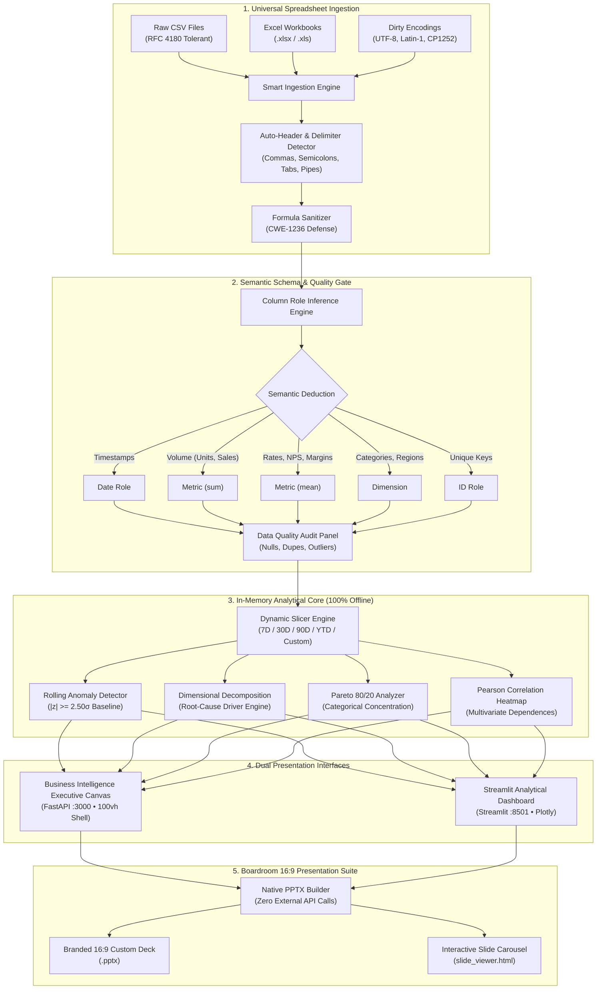

---

## 📊 Business Intelligence Executive Canvas Signature Pages

The Business Intelligence Executive Canvas (`http://localhost:3000`) provides executive-grade analytical precision, desktop ergonomics, and multi-dimensional exploration, structured into **6 signature analytical views**:

```
┌────────────────────────────────────────────────────────────────────────────────────────┐
│ [FILE] [HOME] [INSERT] [MODELING] [VIEW]         BUSINESS INTELLIGENCE EXECUTIVE CANVAS│
├────────────────────────────────────────────────────────────────────────────────────────┤
│                                                                                        │
│   PAGE 1           PAGE 2           PAGE 3          PAGE 4        PAGE 5      PAGE 6   │
│ ┌──────────┐   ┌────────────┐   ┌────────────┐   ┌───────────┐  ┌──────────┐┌─────────┐│
│ │Executive │   │Decomposi-  │   │ Financial  │   │Statistical│  │DataSchema││Deck     ││
│ │ Overview │   │ tion Tree  │   │Matrix Table│   │  Anomaly  │  │  & Query ││ Studio  ││
│ └──────────┘   └────────────┘   └────────────┘   └───────────┘  └──────────┘└─────────┘│
│                                                                                        │
└────────────────────────────────────────────────────────────────────────────────────────┘
```

### 1. Page 1 — Executive Overview & KPI Cockpit
- **Multi-Row KPI Scorecards**: Real-time KPI tiles with primary volumetric values, period-over-period percentage variance badges, and directional health indicators.
- **AI Executive Narrative**: Bulleted boardroom takeaways highlighting top drivers, growth rates, leading segments, and portfolio scale.
- **Dynamic Reactive Visuals**: Interactive Clustered Column, Line, Area, and Stacked Bar charts with rich hover tooltips and dynamic secondary-tier aggregation.
- **Pareto 80/20 Concentration Bar**: Automatically switches between time-series trends and Pareto categorical bars for datasets without date columns.

### 2. Page 2 — Decomposition Tree (AI Visual)
- **Interactive Root-Cause Breakdown**: Explore the primary metric broken down across multiple categorical dimensions simultaneously.
- **Multi-Level Drill Down**: Click any parent branch (e.g., `Category: Technology`) to dynamically expand Level 2 sub-branches (e.g., `Region: EMEA` or `Priority: High`) without alerts or stubs.
- **Visual Progress Bars**: In-branch gradient bars displaying each sub-branch's exact percentage contribution to the parent total.

### 3. Page 3 — Financial Matrix Table
- **Collapsible Row Hierarchies**: Expand and collapse parent categorical rows using interactive chevrons (`▼` / `▶`) with indented child line items.
- **In-Cell Conditional Data Bars**: Micro horizontal gradient bars embedded directly in cells to provide instant visual weight comparison across financial categories.
- **Variance Tracking**: Automatic calculation of Actual vs Budget variance, along with Year-over-Year (YoY) percentage change badges.

### 4. Page 4 — Statistical Anomaly Detector
- **Rolling-Baseline Outlier Detection**: Identifies anomalies where metric values exceed $|z| \ge 2.50\sigma$ against a historical baseline.
- **Risk Metrics**: Quantifies baseline mean, standard deviation, anomaly frequency count, and rolling volatility scores.
- **Interactive Investigation Table**: Filterable anomaly log displaying exact timestamps, flagged values, deviations, and recommended investigation priorities.

### 5. Page 5 — Data Schema & Query Gate
- **Semantic Role Overrides**: Inspect and modify inferred column classifications (`metric`, `dimension`, `date`, `id`, `text`).
- **Aggregation Policy Configuration**: Guardrail controls ensuring volumetric numbers aggregate via `sum` while rates, ratios, and satisfaction scores aggregate via `mean`.
- **Data Quality Health Check**: Review total row count, column count, null percentage, and duplicate record audit before canvas rendering.

### 6. Page 6 — Boardroom Presentation Studio & Deck Customizer
- **Executive Presentation Customizer**: Edit presentation title, enterprise/client name, reporting period, and presenter name in real time.
- **Dynamic Slide Sequencing Manager**: Add custom slides, reorder slides with Move Up / Move Down controls, delete slides, or restore corporate standard defaults.
- **Dashboard Graph Placement Selector**: Dynamically place any dashboard visualization onto each presentation slide:
  - Multi-Metric KPI Scorecards
  - Clustered Column & Trend Combination
  - Pareto 80/20 Categorical Concentration Bar
  - Hierarchical Decomposition Tree
  - Multi-Level Financial Matrix Table
  - Statistical Anomaly Radar & Outlier Log
  - Boardroom Takeaways / Narrative Only
- **Real-Time Executive Takeaways Editor**: Tailor slide-specific narrative bullet points and strategic commentary directly in an embedded editor.
- **Live 16:9 Slide Preview Carousel**: Interactive in-canvas slide deck previewer that updates dynamically as you modify slides and metadata.
- **Air-Gapped Custom PPTX Export**: Compiles customized `.pptx` decks natively using `python-pptx` with 100% offline generation and zero external network calls.

---

## 📂 Preloaded Industry Datasets

Aivara includes **5 enterprise-grade sample datasets** covering key corporate archetypes. You can switch between them instantly using the **Preloaded Samples** ribbon dropdown or test them with custom uploads:

| Dataset | Format | Domain Archetype | Key Metrics & Dimensions | Strategic Questions Answered |
| :--- | :--- | :--- | :--- | :--- |
| **`clean.csv`** | CSV | Commerce & Sales Performance | `Sales`, `Profit`, `Quantity`, `Discount`, `Category`, `Region` | Which product lines yield the highest margins? Which regions generate 80% of revenue? |
| **`Inventory-Records...xlsx`** | Excel | Operations & Warehouse Inventory | `Quantity on Hand`, `Unit Cost`, `Stock Value`, `Warehouse`, `Category` | Where is capital tied up in stock? Which facilities face imminent stockout risks? |
| **`Project-Management...xlsx`**| Excel | Project Portfolio & Resource Ops | `Budget`, `Actual Cost`, `Progress %`, `Owner`, `Priority`, `Status` | Which key initiatives are over budget? How are engineering resources allocated? |
| **`sample_finance_pnl.csv`** | CSV | Corporate P&L & Operating Margin | `Revenue`, `OPEX`, `Operating Margin %`, `Department`, `Quarter` | What is our quarterly margin variance? Which departments drove budget overruns? |
| **`sample_customer_nps.csv`**| CSV | Customer Experience & Feedback | `NPS Score`, `CSAT`, `Sentiment`, `Support Channel`, `Customer Tier` | How does customer satisfaction correlate with support channels across Enterprise tiers? |

---

## 🚀 Quickstart in 60 Seconds

### Prerequisites
- **Python 3.12+**
- **Git**

### Installation

```bash
# 1. Clone the repository
git clone https://github.com/Aivaratechinfomatics/Aivara.git
cd Aivara

# 2. Create and activate an isolated virtual environment
python -m venv .venv

# On Windows (PowerShell):
.venv\Scripts\Activate.ps1
# On macOS / Linux:
source .venv/bin/activate

# 3. Install pinned dependencies
pip install --upgrade pip
pip install -r requirements.txt
```

### Launching the Application

Choose your preferred launcher:

```bash
# Option 1: Launch BOTH Executive BI Canvas (:3000) and Streamlit (:8501)
run_all.bat

# Option 2: Launch Business Intelligence Executive Canvas only (:3000)
run_dashboard.bat
# (Or direct: python dashboard_server.py)

# Option 3: Launch Streamlit Analytical Dashboard only (:8501)
run.bat
# (Or direct: streamlit run app.py)
```

Open your browser to:
- **Business Intelligence Executive Canvas**: [http://localhost:3000](http://localhost:3000)
- **Streamlit Analytical Dashboard**: [http://localhost:8501](http://localhost:8501)

---

## 🛡️ Enterprise Data Privacy & Air-Gapping

Aivara is engineered from the ground up to comply with stringent corporate security and data privacy mandates:

```
┌────────────────────────────────────────────────────────────────────────┐
│                        AIR-GAPPED COMPUTE BOUNDARY                     │
│                                                                        │
│   [Raw Spreadsheets]                                                   │
│           │                                                            │
│           ▼                                                            │
│   [In-Memory Sanitizer] ──> Formula Defense (CWE-1236 Neutralization)   │
│           │                                                            │
│           ▼                                                            │
│   [Local Analytics Engine] ──> Variance, Outliers, Anomaly Math        │
│           │                                                            │
│           ▼                                                            │
│   [Pseudonymizer] ──> Redacts entity names before any narrative prompt │
│           │                                                            │
│           ▼                                                            │
│   [16:9 Presentation Deck] ──> Zero external HTTP requests (Air-Gapped)│
└────────────────────────────────────────────────────────────────────────┘
```

1. **Zero Raw Data Egress**: Raw row-level records never leave your local machine or corporate intranet. All analytical modeling and variance computations are performed in-memory.
2. **Spreadsheet Formula Injection Defense (CWE-1236)**: Untrusted string values starting with `=`, `+`, `-`, `@`, or tab characters are automatically prepended with a single quote (`'`), neutralizing potential Excel formula execution when opening generated reports.
3. **Categorical Entity Pseudonymization**: Proprietary business entities, customer names, and employee identities are pseudonymized into deterministic tokens (e.g., `Category A`, `Entity B`) before generating executive summaries.
4. **Offline Export Verification**: Continuous automated regression tests (`tests/test_export_no_network.py`) strictly guarantee that PowerPoint deck generation makes **0 outbound network calls**.
5. **Daily Budget & Quota Protection**: Built-in daily API budget tracking with visual progress indicators prevents unexpected cloud costs when optional AI summaries are activated.

---

## 🎬 Live Demo Video & Presentation Showcase

Aivara includes precompiled demo artifacts and video recordings showcasing end-to-end ingestion, archetype switching, and slide generation:

- 📹 **Full HD Demo Video (1080p MP4)**: [demo_output/aivara_v1_demo.mp4](demo_output/aivara_v1_demo.mp4)
- 📊 **Generated PowerPoint Presentation (.pptx)**: [demo_output/Aivara_Executive_Presentation.pptx](demo_output/Aivara_Executive_Presentation.pptx)
- 🖥️ **Interactive Slide Deck Carousel**: [demo_output/slide_viewer.html](demo_output/slide_viewer.html)

### Sample 16:9 Executive PowerPoint Presentation (.pptx) Slides

| Slide 1: Cover Title & Metadata | Slide 3: Primary KPI Scorecard |
| :---: | :---: |
| 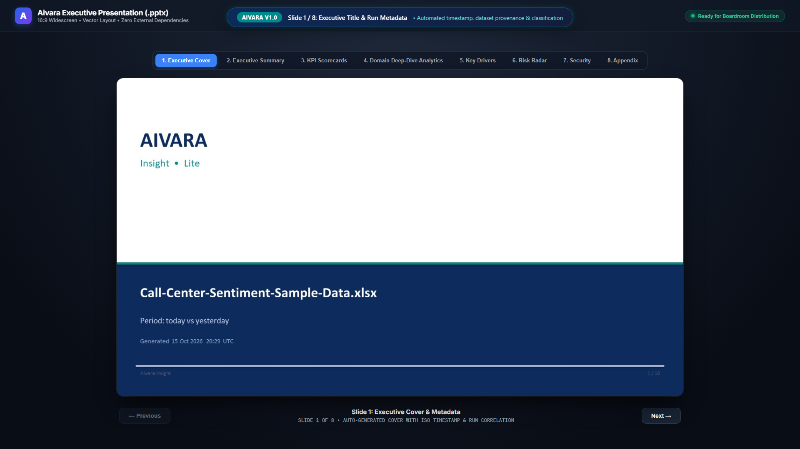 | 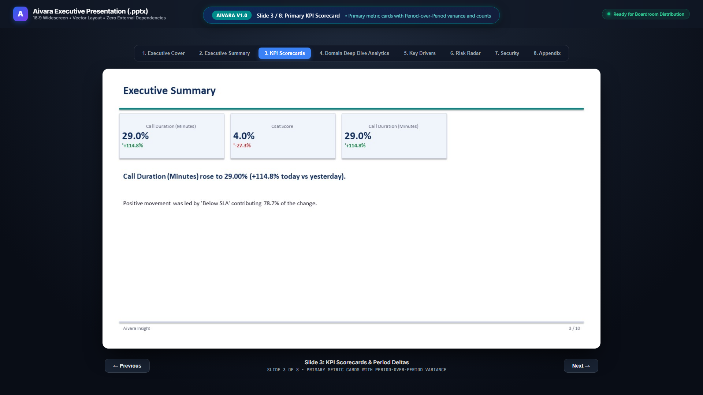 |

| Slide 4: Domain Analytics Deep-Dive | Slide 5: Key Explanatory Drivers |
| :---: | :---: |
| 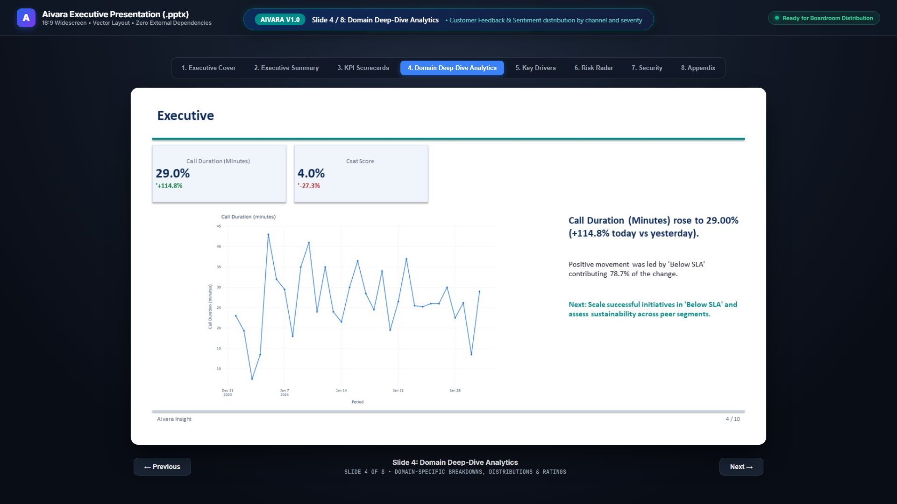 | 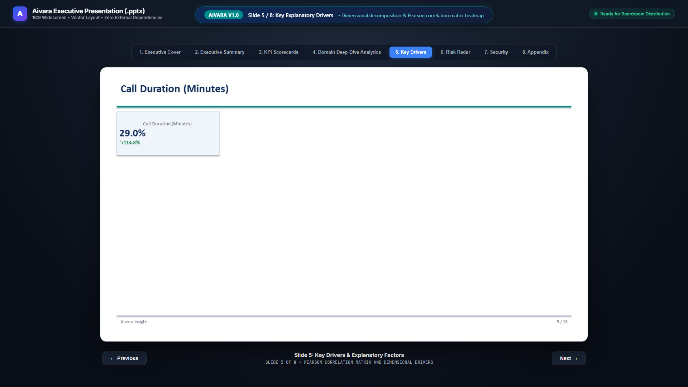 |

| Slide 7: Enterprise Security & Sanitization | Export Ready Confirmation |
| :---: | :---: |
| 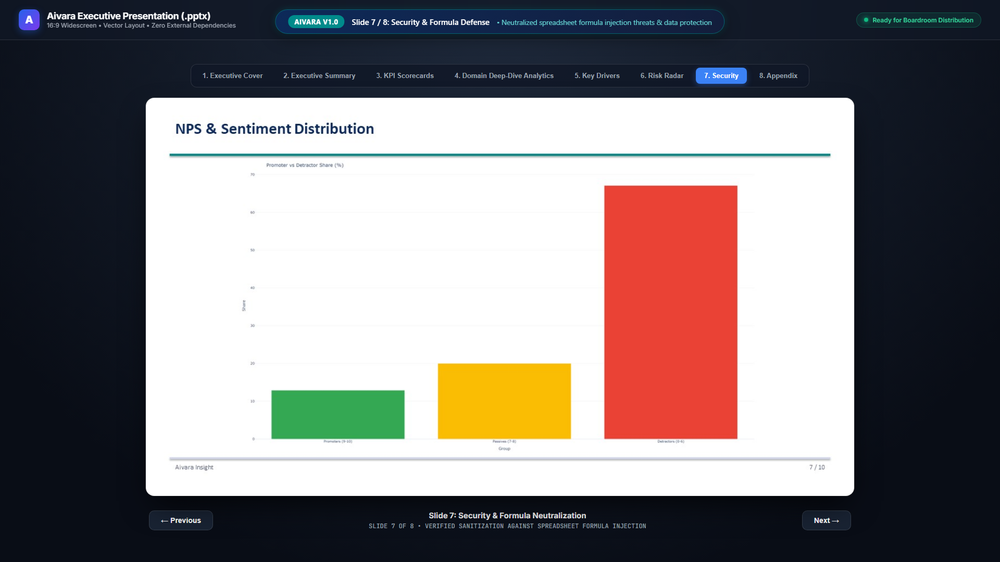 | 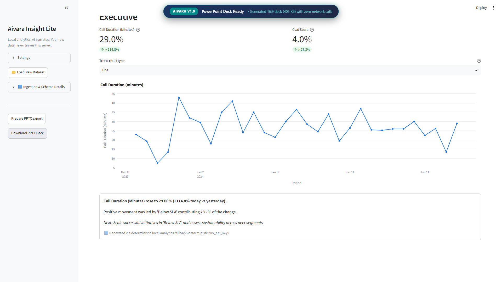 |

### Interactive Application Workflow

| 1. Landing Page & Universal Ingestion | 2. Data Quality Audit Panel |
| :---: | :---: |
| 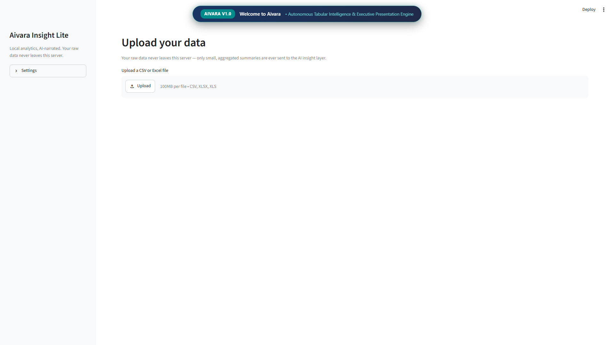 |  |

| 3. Semantic Schema Review Gate | 4. Elevated Executive Dashboard |
| :---: | :---: |
| 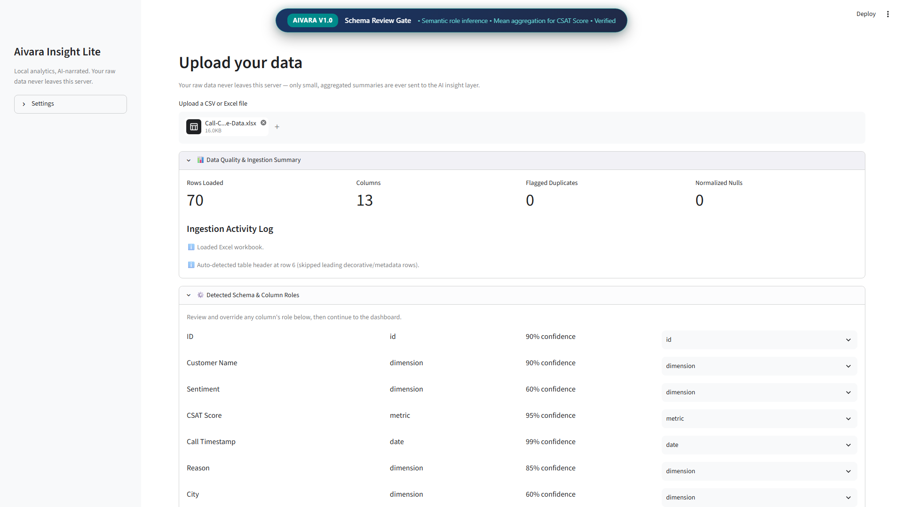 | 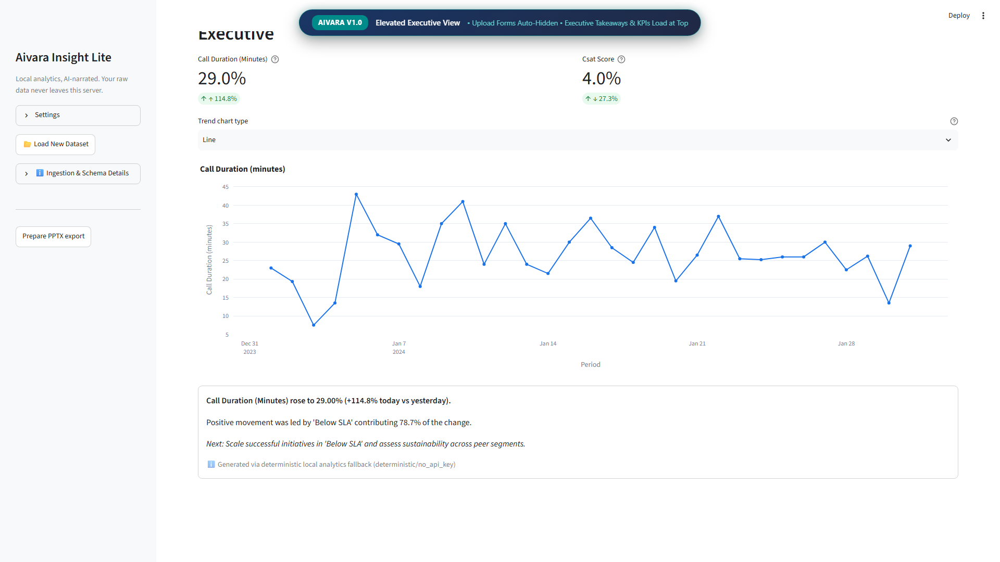 |

| 5. Operations Inventory Snapshot | 6. Security, Pseudonymization & Budget |
| :---: | :---: |
| 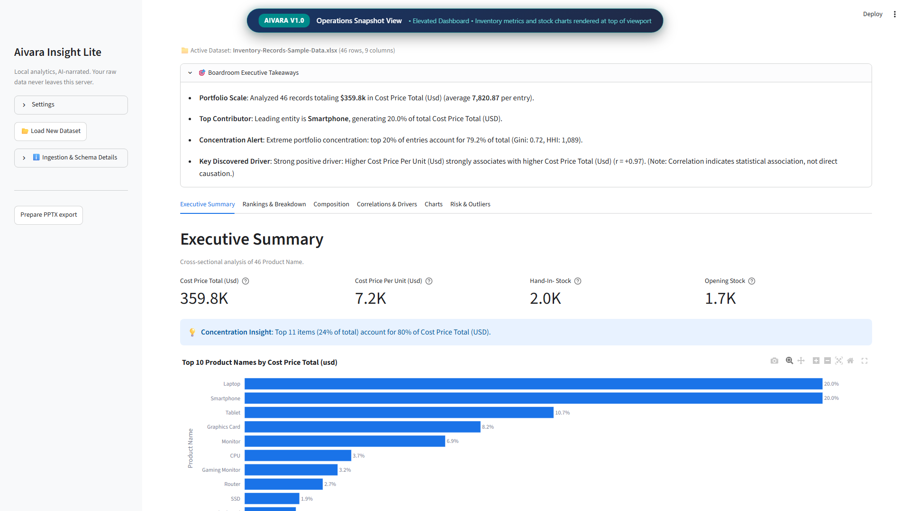 | 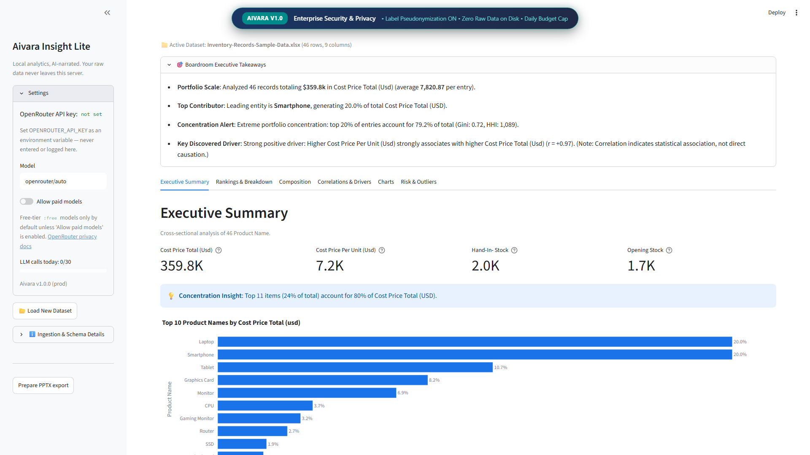 |

---

## 🛠️ Internship & Developer Verification Guide (Batch Starting 19 Oct 2026)

Welcome to the **Aivara Engineering & Data Analytics Internship**. All interns and contributors must follow this verification protocol to validate new features, test custom datasets, and ensure all quality gates pass before opening pull requests.

### Intern Verification Checklist

1. **Universal File Ingestion**:
   - Ingest multiple file types (CSV, `.xlsx`, `.xls`) with mixed encodings and delimiters.
   - Confirm auto-header detection correctly identifies tabular headers past decorative title blocks.
2. **Schema & Semantic Role Review**:
   - Verify that columns are classified accurately (`date`, `metric`, `dimension`, `id`).
   - Confirm volumetric metrics default to `sum` and rate/ratio metrics default to `mean`.
3. **Business Intelligence Executive Canvas Verification (`:3000`)**:
   - Ensure the canvas maintains a **strict 100vh layout** with no whole-page scroll jump.
   - Verify that date slicers (`7D`, `30D`, `90D`, `YTD`, `ALL`) dynamically recalculate KPI scorecards and chart aggregates.
   - Switch between all 6 signature page tabs:
     - **Page 1**: Verify chart tooltips, secondary tier grouping, and Pareto distribution fallback.
     - **Page 2**: Click parent nodes in the Decomposition Tree and confirm Level 2 branches expand smoothly.
     - **Page 3**: Click row chevrons (`▼` / `▶`) in the Financial Matrix to expand child line items and inspect conditional data bars.
     - **Page 4**: Inspect the Anomaly Detector table for records with $|z| \ge 2.50\sigma$.
     - **Page 5**: Modify a column role and click **Apply Schema Changes**.
     - **Page 6**: In the **Boardroom Deck Studio**, customize presentation metadata, add/reorder slides, select graph placements, edit narrative notes, and verify custom `.pptx` generation.
4. **Streamlit Analytical Dashboard Verification (`:8501`)**:
   - Ingest a dataset, review schema, and click **Confirm schema and build dashboard**.
   - Confirm upload boxes collapse to elevate KPI scorecards and charts to the top of the viewport.

### Quality Gates & Automated Regression Battery

All **324+ automated tests** must pass without warnings before code changes are merged:

```bash
# 1. Run complete automated test suite
pytest tests/ -v

# 2. Run Executive Canvas 13-Defect Audit Regression Battery
pytest tests/test_audit_13_bugs.py -v

# 3. Run FastAPI Executive BI Gateway and Asset Integrity Tests
pytest tests/test_dashboard_frontend.py -v

# 4. Run Chromium Headless Playwright Interactive E2E Tests
pytest tests/test_playwright_e2e.py -v

# 5. Run Headless Streamlit AppTest Suite
pytest tests/test_ui_apptest.py -v

# 6. Run Core Mathematical Invariant Consistency Tests
pytest tests/test_core_correctness.py -v

# 7. Run Air-Gapped Network Isolation Tests
pytest tests/test_export_no_network.py -v

# 8. Run Code Linter and Formatter Checks
python -m ruff check .
python -m ruff format --check .
```

---

## 🛡️ Anti-Reverse Engineering & Intellectual Property Protection

To safeguard core analytical algorithms, proprietary heuristic engines, and institutional client data against reverse engineering, unauthorized cloning, and IP exfiltration, all contributors, interns, and deployment engineers must strictly adhere to the following security protocols:

### 1. Proprietary Core IP & Trade Secrets
- **Proprietary Heuristic Engines**: Aivara's core heuristic classifiers, automated semantic role deduction, dimensional variance decomposition, rolling-baseline anomaly algorithms ($|z| \ge 2.50\sigma$), and air-gapped facts synthesis are proprietary intellectual property of **Aivara Technologies** and **DBERT AI Venture Studio**.
- **Strict Prohibition on Public LLM Uploads**: Interns and developers must **NEVER** copy, upload, or paste internal algorithms, proprietary prompt templates, or raw business logic into public LLM interfaces (e.g., public ChatGPT, Claude, or Gemini chats). Doing so compromises trade secrets and violates your Non-Disclosure Agreement (NDA).

### 2. Zero Raw Data Egress & Network Air-Gapping
- Under the **Compute-First Principle**, raw user rows and internal business datasets are **never transmitted over external networks**.
- Automated regression tests in `tests/test_export_no_network.py` continuously enforce that the presentation export package contains zero external network dependencies and cannot be weaponized as an exfiltration vector.

### 3. Code Hardening & Anti-Tamper Invariants
- **Runtime Invariant Testing**: The test suite enforces strict mathematical regression invariants (`test_core_correctness.py`) ensuring that calculation engines cannot be modified, weakened, or silently tampered with.
- **Binary Packaging & Protected Bytecode**: For enterprise customer distribution, core modules are packaged via compiled CPython bytecode / Cython binary extensions (`.pyd`/`.so`) and deployed as hardened non-root container images without source files.
- **Formula Injection Defense**: All generated exports enforce sanitization against spreadsheet formula injection attacks (CWE-1236), neutralizing untrusted user inputs with prepended characters.

### 4. Legal Compliance & Contributor IP Assignment
- Contributions made during the **DBERT Internship Program** and **Aivara Technologies Development Cohorts** are governed by formal Intellectual Property Assignment and Confidentiality agreements.
- Unauthorized disassembly, reverse engineering, unauthorized public forks, or exfiltration of proprietary analytical assets will result in immediate termination, revocation of completion credentials, and legal enforcement under applicable copyright and trade secret laws.

---

## 🏛️ Built by Aivara Technologies & DBERT AI Venture Studio

**Aivara Insight** was architected and built by the engineering squad at [Aivara Technologies](https://aivaratech.online/) in partnership with [DBERT](https://dbert.online/) — India's premier AI Venture Studio, Delhi.

DBERT (Digital Blinc Education Research & Technology) incubates transformative AI products, ships institutional enterprise platforms, and trains top-tier engineers. Aivara is actively developed under the Aivara Engineering & Analytics Internship Program, Batch Oct–Dec 2026.

- 🌐 **Aivara Website**: [aivaratech.online](https://aivaratech.online/)
- 🌐 **DBERT Website**: [dbert.online](https://dbert.online/)
- 📂 **Startup Portfolio**: [dbert.online/startups/portfolio](https://dbert.online/startups/portfolio)
- 🎓 **DBERT Fellowship Program**: [dbert.online/learners/fellowship](https://dbert.online/learners/fellowship)
- 💼 **Internship Portal**: [aivaratech.online/internships](https://aivaratech.online/internships)

---

## 📄 License

Aivara is open-source software licensed under the [Apache License, Version 2.0](LICENSE).
