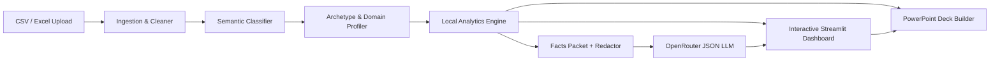

# Aivara — Autonomous Tabular Analytics & Executive Deck Generation

[](config.py)
[](LICENSE)
[](pyproject.toml)
[](tests/)
[](docs/TESTING.md)
[](docs/SECURITY.md)

**Aivara** is a production-grade, locally hosted data intelligence platform that ingests arbitrary business spreadsheets (CSV and Excel), automatically infers structure and domain semantics, computes statistical metrics locally, enriches findings with structured AI narrative takeaways, and exports branded, executive-ready PowerPoint (`.pptx`) presentation decks.

---

## Key Principles & Features

- **Compute-First Principle**: All numerical operations, period-over-period comparisons, driver ranking, correlation matrices, and anomaly detections are computed locally in Python and pandas. LLMs are never asked to perform arithmetic.
- **Strict Data Privacy**: Raw user row data is **never persisted to disk or database** and **never transmitted over the network**. Only compact, aggregated statistical facts packets (100–300 tokens) are sent to OpenRouter.
- **Label Redaction by Default**: Entity names and categorical labels are pseudonymized (`Category A`, `Entity B`) before LLM egress (`AIVARA_LLM_REDACT_LABELS=true`), protecting sensitive business identifiers.
- **Universal Spreadsheet Ingestion**: Tolerant ingestion engine automatically detects delimiters (comma, semicolon, tab, pipe), character encodings (UTF-8, UTF-16, Latin-1, CP1252), header offsets, compact dates (`YYYYMMDD`), and percentage scaling.
- **Statistical Rigor**: Distinguishes volumetric totals (`sum`) from rates, ratios, and averages (`mean`), preventing statistical errors like summing conversion rates or NPS.
- **Executive Presentation Deck Export**: One-click generation of branded 16:9 widescreen PowerPoint decks with Plotly chart graphics, KPI scorecards, driver tables, and formula injection defense (CWE-1236).
- **Hardened Security & Multi-Process Concurrency**: Reverse-proxy identity support (`X-Forwarded-User`), constant-time shared secret verification, non-root Docker runtime, SQLite Write-Ahead Logging (WAL) state stores, and SSRF egress blocking.

---

## Architecture Overview



For complete technical specifications, see [docs/ARCHITECTURE.md](docs/ARCHITECTURE.md).

---

## Quickstart

### Option 1: Local Development (Python 3.12+)

```bash
# 1. Clone the repository
git clone https://github.com/Aivaratechinfomatics/Aivara.git
cd Aivara

# 2. Create and activate a virtual environment
python -m venv .venv
source .venv/bin/activate  # On Windows: .venv\Scripts\activate

# 3. Install dependencies
pip install -r requirements.txt

# 4. Configure environment variables
cp .env.example .env
# Edit .env and supply your OPENROUTER_API_KEY (optional for offline testing)

# 5. Launch the application
streamlit run app.py
```

Open your browser to `http://localhost:8501`.

### Option 2: Production Container (Docker Compose)

```bash
# 1. Configure environment file
cp .env.example .env

# 2. Build and launch services in detached mode
docker compose up -d --build

# 3. Verify container health
python scripts/smoke_container.py --url http://localhost:8501
```

---

## Configuration Reference

Aivara is configured via environment variables or a `.env` file. Settings are strongly typed and validated at startup:

| Variable | Description | Type | Default |
| :--- | :--- | :--- | :--- |
| `AIVARA_ENV` | Environment profile (`dev`, `staging`, `prod`) | string | `prod` |
| `OPENROUTER_API_KEY` | OpenRouter API authentication key | string | `""` |
| `AIVARA_MODEL` | Primary LLM model identifier | string | `openrouter/auto` |
| `AIVARA_FALLBACK_MODEL` | Offline/free fallback model | string | `meta-llama/llama-3.1-8b-instruct:free` |
| `AIVARA_DAILY_BUDGET` | Maximum allowed outbound LLM calls per UTC day | int | `30` |
| `AIVARA_MAX_OUTPUT_TOKENS`| Output token cap per insight generation call | int | `150` |
| `AIVARA_LLM_REDACT_LABELS`| Pseudonymize categorical labels in outbound facts packets | bool | `true` |
| `AIVARA_AUTH_REQUIRED` | Fail closed if reverse-proxy auth or secret is missing | bool | `false` |
| `AIVARA_SHARED_SECRET` | Shared secret passphrase for standalone authentication | string | `""` |
| `AIVARA_CACHE_ENABLED` | Enable persistent SQLite insight caching | bool | `true` |
| `AIVARA_CACHE_TTL_DAYS` | Retention period in days for cached insights | int | `7` |
| `AIVARA_CACHE_MAX_ENTRIES`| Maximum number of entries in the LRU insight cache | int | `1000` |
| `AIVARA_KALEIDO_TIMEOUT` | Timeout in seconds for headless chart export rendering | float | `15.0` |

For complete configuration rules and parameter validation, see [docs/CONFIGURATION.md](docs/CONFIGURATION.md).

---

## Supported Domain Analytics Packs

Aivara automatically classifies datasets into one of three archetypes and six business domains:

1. **Executive Overview**: High-level KPI scorecard, period-over-period delta tracking, primary trend analysis, and automated executive takeaways.
2. **Commerce / Retail**: Gross merchandise value, Average Order Value (AOV), customer cohort retention, SKU velocity, and refund rates.
3. **Finance & Accounting**: Operating margin %, revenue vs. OPEX trends, budget variance, and gross margin analysis.
4. **Workforce & HR**: Department headcount distribution, compensation bands, tenure distribution, and turnover/attrition risk indicators.
5. **Customer Feedback**: Net Promoter Score (NPS) breakdown, customer satisfaction (CSAT) trends, and resolution latency.
6. **Operations & Snapshot**: Warehouse inventory levels, stockout risks, project milestone tracking, and task completion rates.

---

## Sizing Limits & Performance SLAs

Aivara enforces defensive boundaries to protect memory and responsiveness:

- **Upload Size Limit**: 100 MB max (`MAX_UPLOAD_MB`).
- **Column Limit**: 500 columns max (`MAX_COLUMNS`).
- **Row Limit**: 500,000 rows max (`MAX_ROWS_FULL_PROCESSING`). Files exceeding 500k rows are deterministically sampled down to 500k rows with visible UI notifications.
- **Latency SLA**: 10,000 rows process through cleaning, classification, profiling, and analytics in **< 5 seconds** (Peak RAM < 3 MB).
- **Concurrency**: 5 concurrent analytical sessions process ~4,600 rows/second with zero state interference across sessions.

For detailed benchmarks and hardware sizing profiles, see [docs/PERFORMANCE.md](docs/PERFORMANCE.md).

---

## Quality Assurance & Verification

Aivara maintains an automated regression battery with strict offline isolation (unauthorized socket calls are blocked):

```bash
# Run complete test suite (306 tests)
pytest tests/ -v

# Run with test coverage analysis (requires >= 75% coverage)
python -m pytest tests/ --cov=config --cov=analytics --cov=ingestion --cov=export --cov=insight --cov=ui --cov=infra --cov=app -q

# Run static quality and security scans
python -m ruff check .
python -m ruff format --check .
python -m mypy config.py analytics/ ingestion/ export/ insight/ ui/ infra/ scripts/ app.py
python -m bandit -r analytics/ ingestion/ export/ insight/ ui/ infra/ config.py app.py -ll

# Run User Acceptance Testing (UAT) across 5 domain datasets
python scripts/uat_verify.py

# Run performance benchmark harness
python scripts/bench.py
```

For detailed testing guidelines, see [docs/TESTING.md](docs/TESTING.md).

---

## Documentation Index

- [Architecture Guide](docs/ARCHITECTURE.md): System components, data pipelines, and design invariants.
- [User Guide](docs/USER_GUIDE.md): Preparing data, schema review, interpreting views, and PowerPoint export.
- [Configuration Reference](docs/CONFIGURATION.md): Environment variables, defaults, and validation rules.
- [Security & Deployment Guide](docs/SECURITY.md): Reverse-proxy auth, TLS, Docker hardening, and vulnerability reporting.
- [Threat Model](docs/THREAT_MODEL.md): STRIDE-lite threat analysis, trust boundaries, and mitigations.
- [Operations Runbook](docs/RUNBOOK.md): Startup, monitoring, backup, secret rotation, and incident responses.
- [Performance & Scale Guide](docs/PERFORMANCE.md): Benchmark results, hardware sizing, and concurrency metrics.
- [Testing Guide](docs/TESTING.md): Quality gates, fixtures, golden tests, and test execution.
- [State Inventory](docs/STATE_INVENTORY.md): Session state mapping and persistence boundaries.

---

## Repository Layout

```
aivara/
├── app.py                  # Streamlit entrypoint orchestrator (< 120 lines)
├── config.py               # Strongly typed Settings, constants, and semver
├── ingestion/              # Delimiter/encoding sniffing, cleaning, and classification
├── analytics/              # Local KPIs, trends, drivers, stats, and domain packs
│   └── domains/            # Commerce, Finance, Workforce, and Feedback modules
├── insight/                # Facts packet builder, pseudonymizer, budget, and OpenRouter client
├── ui/                     # Streamlit tab registry, components, auth, and error boundaries
├── export/                 # Branded PowerPoint builder, chart exporter, and formula sanitizer
├── infra/                  # Structured JSON logging and secret redaction
├── scripts/                # Verification scripts: bench.py, smoke_container.py, uat_verify.py
├── docs/                   # Architecture, user guide, testing, security, and operations docs
├── tests/                  # Exhaustive pytest battery (unit, golden, security, UI AppTest)
├── docker-compose.yml      # Production container composition with named volume
├── Dockerfile              # Multi-stage non-root container definition
├── pyproject.toml          # Ruff, Mypy, and Pytest configuration
├── requirements.txt        # Pinned runtime dependencies
└── .env.example            # Documented environment variable template
```

---

## License

Aivara is open-source software licensed under the [Apache License, Version 2.0](LICENSE).
