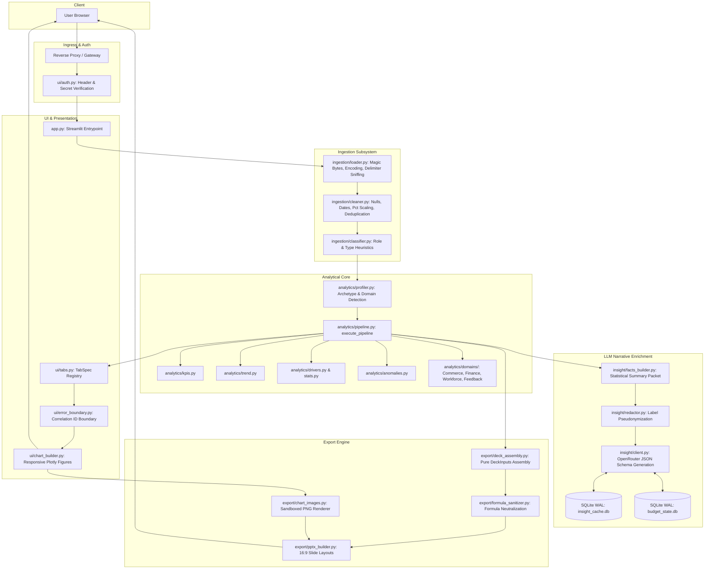

# Aivara Architecture Guide (v1.0.0)

This document describes the high-level system design, subsystem interfaces, data flows, security boundaries, and runtime architectural principles of **Aivara**.

---

## 1. Architectural Principles

1. **Compute-First Principle**: All numerical computation, time-series resampling, driver ranking, correlation matrices, and anomaly detections are executed locally via vectorized Python/pandas algorithms. Large Language Models (LLMs) are never tasked with arithmetic.
2. **Zero Raw Row Data Persistence**: Raw uploaded CSV/Excel records exist exclusively in volatile memory for the duration of an analytical session. No row-level dataset records are written to persistent databases or disk.
3. **Fail-Closed Security**: Egress filtering blocks SSRF to private/internal IPs, authentication fails closed when required, and formula injections are actively neutralized in all output formats.
4. **Degraded-Soft Presentation**: Component errors, network timeouts, or missing optional graphics never crash peer views or presentations. Subsystems cleanly degrade to informative notices, deterministic fallbacks, or placeholder cards.

---

## 2. End-to-End System Diagram

---

## 3. Subsystem Breakdown

### 3.1 Ingestion & Normalization (`ingestion/`)
- **Ingestion Loader (`loader.py`)**:
  - Validates file headers against executable magic bytes (PE, ELF, Mach-O, Java class) and null bytes.
  - Automatically identifies encoding (`utf-8`, `utf-8-sig`, `latin-1`, `cp1252`) and delimiters (`,`, `;`, `\t`, `|`).
  - Strips leading metadata rows, detects true table header offsets, and prunes trailing summary rows ("Total", "Grand Total").
  - Enforces `MAX_UPLOAD_MB = 100`, `MAX_COLUMNS = 500`, and `MAX_ROWS_FULL_PROCESSING = 500,000` (stratified random sampling with load notes).
- **Cleaner (`cleaner.py`)**:
  - Standardizes missing value tokens (`DEFAULT_NULL_STRINGS`).
  - Normalizes 8-digit compact dates (`YYYYMMDD`).
  - Auto-scales percentage columns (`x / 100.0` when max > 1.0) and assigns `%` units.
  - Tracks coercion failures per column in `CleanReport`.
- **Semantic Classifier (`classifier.py`)**:
  - Classifies columns into roles: `date_col`, `metrics` (numeric aggregates), `dimensions` (categorical groupings), and `id_cols` (keys/identifiers).
  - Infers appropriate metric aggregations (`sum` for volumetric metrics, `mean` for rates/ratios/NPS/percentages).

### 3.2 Profiling & Analytics Engine (`analytics/`)
- **Dataset Profiler (`profiler.py`)**:
  - Assigns an archetype based on schema morphology: `timeseries` (longitudinal date series), `snapshot` (static single-period records), or `project` (task/phase tracking).
  - Detects specialized business domains: `commerce`, `finance`, `workforce`, `feedback`, or `generic`.
- **Pipeline Orchestrator (`pipeline.py`)**:
  - Coordinates specialized sub-pipelines (`build_snapshot_pipeline`, `build_project_pipeline`, `build_timeseries_pipeline`).
  - Returns a strongly typed `PipelineResult` dataclass with backward-compatible dictionary semantics.
- **Statistical Modules**:
  - `kpis.py`: Current vs. prior period metrics, absolute deltas, percentage changes.
  - `trend.py`: Adaptive frequency resampling (daily, weekly, monthly, quarterly).
  - `drivers.py` & `stats.py`: Categorical driver ranking, Pearson correlation matrix ($n \ge 5$), Herfindahl concentration index.
  - `anomalies.py`: Temporal rolling baseline anomalies with z-scores, alongside structural outlier flags.
  - `domains/`: Domain KPI packs for gross margin, budget variance, attrition rates, and NPS scores.

### 3.3 LLM Narrative Enrichment (`insight/`)
- **Facts Packet Builder (`facts_builder.py`)**:
  - Condenses computed analytical results into a compact JSON payload (100–300 tokens).
- **Label Redaction (`redactor.py`)**:
  - When enabled (`AIVARA_LLM_REDACT_LABELS=true`), maps categorical values and entity names to stable pseudonyms (`Category A`, `Entity B`) prior to egress, and unredacts narratives locally before display.
- **OpenRouter Client (`client.py`)**:
  - Communicates with OpenRouter via HTTPS (`https://openrouter.ai/api/v1/chat/completions`).
  - Validates outbound URLs against SSRF allowlists, rejecting internal/private IP ranges.
  - Enforces structured JSON output schema (`{headline, driver, action}`).
  - Employs 1-shot repair prompts and faithfulness validation against ground-truth facts.
- **Persistence & Budget**:
  - Persistent SQLite Write-Ahead Logging (WAL) databases: `insight_cache.db` and `budget_state.db`.
  - Atomic transactions with 5000ms busy timeouts for multi-process safety.
  - Daily ceiling (`AIVARA_DAILY_BUDGET`) and LRU/TTL expiration.

### 3.4 Presentation & UI Orchestrator (`ui/`, `app.py`)
- **Top-Level Orchestrator (`app.py`)**:
  - Streamlined routing (< 120 lines).
  - Evaluates authentication gate (`ui/auth.py`), file ingestion, session state, and tab dispatch.
- **Table-Driven Tab Registry (`tabs.py`)**:
  - Declarative `TabSpec` definitions per domain and archetype.
- **Component Error Boundary (`error_boundary.py`)**:
  - Captures tab exceptions, generates a unique correlation ID (`uuid4().hex[:8]`), logs diagnostics, and prevents unhandled exceptions from blanking peer views.

### 3.5 Presentation Export Engine (`export/`)
- **Deck Assembly (`deck_assembly.py`)**:
  - Pure function mapping pipeline results into `DeckInputs` without Streamlit dependencies.
- **PowerPoint Builder (`pptx_builder.py`)**:
  - Generates 16:9 widescreen presentation decks using branded Aivara palettes.
  - Dynamic slide layouts for Executive Summary, Table of Contents, KPI grids, driver tables, and Plotly charts.
  - Slide placeholder cards render when graphics fail or time out.
- **Formula Injection Defense (`formula_sanitizer.py`)**:
  - Neutralizes spreadsheet formula characters (`=`, `+`, `-`, `@`, `\t`, `\r`) in slide text, tables, and data exports.
- **Chart Image Exporter (`chart_images.py`)**:
  - Converts Plotly figures to 1920x1080 PNG images via Kaleido, protected by a 15-second ThreadPoolExecutor timeout.
  - 100% offline isolation: zero outbound network calls.

### 3.6 Observability & Infrastructure (`infra/`, `config.py`)
- **Configuration (`config.py`)**:
  - Strongly typed `Settings` dataclass with startup validation (`.from_env()`).
- **Structured JSON Logging (`infra/logger.py`)**:
  - JSON formatting for log aggregators (Datadog, Elasticsearch, CloudWatch).
  - Automatic secret redaction (`redact_secrets`) scrubbing API keys and bearer tokens.
  - Audit logging (`aivara.audit.llm`) tracking model names and token consumption without recording prompt contents.
