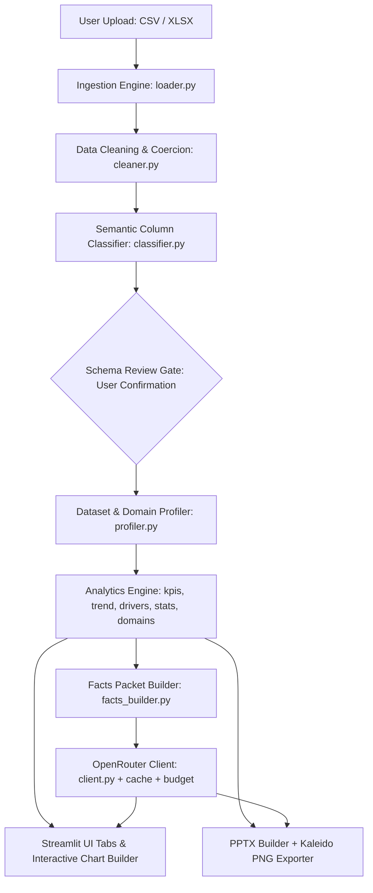

# Aivara Insight Lite — Current Architecture Document (Baseline)

## 1. System Overview
Aivara Insight Lite is an autonomous data intelligence application built with Python, Streamlit, pandas, Plotly, python-pptx, and OpenRouter LLMs. It ingests tabular business datasets (CSV and Excel), classifies column semantic roles, profiles the dataset archetype and domain, computes statistical metrics locally (Compute-First Principle), synthesizes natural language executive insights via OpenRouter, renders an interactive Streamlit UI, and exports branded widescreen PPTX presentation decks.

---

## 2. Component Pipeline

### 2.1 Ingestion & Normalization (`ingestion/`)
- **`loader.py`**:
  - Ingests CSV or Excel (`.xlsx` via `openpyxl`).
  - Auto-detects delimiters (`,`, `;`, `\t`, `|`) using `csv.Sniffer`.
  - Encodings fallback: `utf-8`, `utf-8-sig`, `latin-1`, `cp1252`.
  - Strips trailing summary rows (e.g. "Grand Total", "Total") via `_prune_trailing_summary_rows`.
  - Unpivots wide monthly matrix columns into longitudinal records via `_detect_wide_matrix`.
- **`cleaner.py`**:
  - Detects and coerces 8-digit compact dates (`YYYYMMDD`).
  - Auto-scales percentage columns (`x / 100.0` when max > 1.0).
  - Normalizes null placeholders (`N/A`, `NULL`, `none`, `-`) to `np.nan`.
  - Coerces numeric columns with `errors='coerce'`, tracking failed coercion counts in `CleanReport`.
- **`classifier.py`**:
  - Classifies columns into roles: `date_col`, `metrics` (numeric aggregates), `dimensions` (categorical groupings), `id_cols` (keys/identifiers), and `low_confidence_cols`.
  - Distinguishes numeric codes/IDs from dimensional categories using cardinality ratios.

### 2.2 Profiling & Archetype Detection (`analytics/profiler.py`)
- Evaluates dataset structure to assign an archetype:
  - **`timeseries`**: Datasets with a recognized date dimension and numeric metrics over time.
  - **`snapshot`**: Single-point-in-time inventory, catalog, or static records without valid date timelines.
  - **`project`**: Tasks, milestones, status flags, completion rates, start/end dates.
- Detects business domain:
  - **`commerce`**: Orders, revenue, customer ID, SKU, product category.
  - **`finance`**: Revenue, expenses, OPEX, COGS, budget variance, margins.
  - **`workforce`**: Employees, headcount, departments, salaries, attrition.
  - **`feedback`**: Customer ratings, NPS, satisfaction scores, survey reviews.
  - **`generic`**: Default domain when heuristics do not specialize.

### 2.3 Analytics Computation (`analytics/`)
- **Compute-First Principle**: All calculations are strictly local in pandas; LLMs never perform arithmetic.
- **`kpis.py`**:
  - Identifies primary metric (largest absolute sum/activity).
  - Determines aggregation method (`mean` for rates/percentages, `sum` for volumetric totals).
  - Calculates current period vs. prior period metrics and percentage delta via `format_pct_change`.
  - Detects revenue and cost pairs to compute gross margin percentage.
- **`trend.py`**:
  - Automatically selects time granularity (daily, weekly, monthly) based on date span.
  - Resamples primary metric into aligned time intervals and splits current vs. prior intervals.
- **`drivers.py`**:
  - Computes categorical contribution to metric variance between periods.
  - Calculates categorical concentration index (Herfindahl-Hirschman variation).
- **`anomalies.py`**:
  - Identifies category-level outliers using z-score thresholds.
- **`stats.py`**:
  - Correlation matrices, Pareto distributions, categorical skewness, and automated template-based executive takeaways.
- **`domains/`**:
  - Domain-specific metric calculators (`commerce.py`, `finance.py`, `workforce.py`, `feedback.py`).

### 2.4 Insight Synthesis (`insight/`)
- **`facts_builder.py`**:
  - Serializes verified analytical figures into a condensed JSON facts packet.
  - Strips infinities and NaNs to avoid prompt contamination.
- **`prompts.py`**:
  - Strict system prompt constraining the LLM to cite only provided facts.
- **`client.py`**:
  - Connects to OpenRouter (`meta-llama/llama-3-8b-instruct:free` default, paid models configurable).
  - Manages timeouts, retries, and fallback handling.
- **`budget.py`**:
  - File-based daily token and USD spending limiter (`.aivara_budget_state.json`) with `threading.Lock`.
- **`cache.py`**:
  - File-based cache (`.aivara_insight_cache.json`) keyed by prompt/facts hash.

### 2.5 Presentation & Export (`ui/` and `export/`)
- **`ui/`**:
  - Multi-tab layout routed according to profile (`executive_view`, `revenue_view`, `drivers_view`, `risk_view`, `snapshot_view`, `project_view`, `stats_view`, `chart_builder`).
  - Interactive Plotly figures with cohesive branding and theme palette.
  - Ad-hoc chart explorer supporting 16 distinct chart archetypes (`chart_builder.py`).
- **`export/`**:
  - `pptx_builder.py`: Generates 16:9 presentation decks with brand styling, typography, KPI cards, data tables, and AI takeaways.
  - `chart_images.py`: Converts Plotly figures to static PNG images via `kaleido` for embedding in PowerPoint slides.
