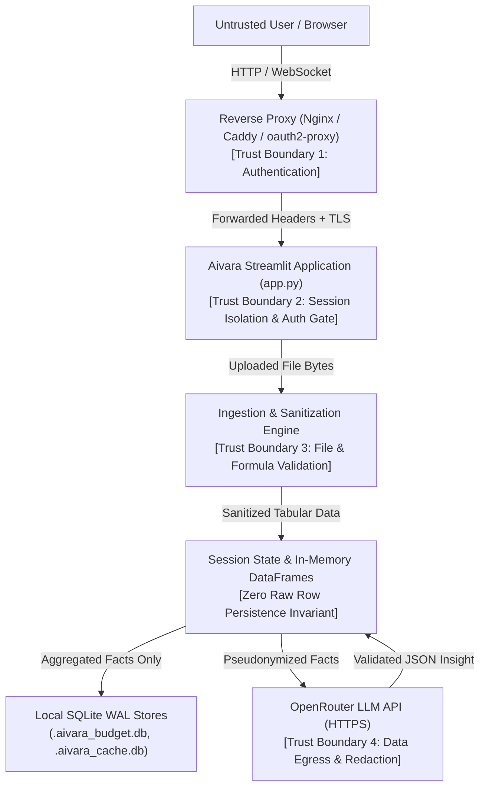

# Aivara Insight Lite — Threat Model (STRIDE-Lite)

Last updated: 2026-10-15  
Status: Active (Phase 7)  
Scope: Aivara Insight Lite core engine, Streamlit UI, ingestion pipeline, export builder, and LLM proxy client.

---

## 1. System Architecture & Trust Boundaries

### Trust Boundaries
1. **Boundary 1 (Client to Ingress):** Untrusted web clients accessing via HTTP/HTTPS. Reverse proxy handles TLS termination, authentication, and forwarding headers.
2. **Boundary 2 (App Ingress Gate):** Aivara application layer validating reverse-proxy authentication headers (`X-Forwarded-User`) or checking app-level shared secret (`AIVARA_SHARED_SECRET`). Fails closed if auth is required (`AIVARA_AUTH_REQUIRED=true`).
3. **Boundary 3 (Data Ingestion Boundary):** Uploaded files (CSV, TSV, Excel) are treated as untrusted input. Validated for file size, column limits, executable magic bytes, null-byte bombs, path traversal filenames, and formula injection.
4. **Boundary 4 (Egress Boundary to LLM):** Network egress to OpenRouter. Restricted to allowlisted domains (`openrouter.ai`) over HTTPS. Categorical and entity labels are pseudonymized before transmission (`AIVARA_LLM_REDACT_LABELS=true`). Zero raw row data is ever transmitted.

---

## 2. Asset Inventory

| Asset ID | Asset Name | Description | Sensitivity | Invariant |
|---|---|---|---|---|
| **A1** | Uploaded Business Data | Raw rows of CSV/Excel uploaded by users (financials, sales, workforce, customer records). | HIGH | In-memory only; NEVER written to persistent disk; NEVER sent in raw form to external LLMs. |
| **A2** | OpenRouter API Key | Secret credential (`OPENROUTER_API_KEY`) used for LLM queries. | HIGH | Read from environment only; NEVER logged; masked in UI (`sk-...cdef`); placeholders rejected at startup. |
| **A3** | Aggregated Insights & Facts | Summary metrics, drivers, anomalies, and LLM generated executive takeaways. | MEDIUM | Scoped strictly to current user session; facts cached with SHA-256 hash only. |
| **A4** | Budget & Cache Databases | Local SQLite WAL databases (`.aivara_budget.db`, `.aivara_cache.db`). | MEDIUM | Contains call counts and SHA-256 facts hashes; no raw rows; auto-pruned via TTL/LRU. |
| **A5** | Application Container | Container environment and host filesystem. | HIGH | Runs as non-root user (`aivara:10001`); minimal attack surface; healthy via Docker HEALTHCHECK. |

---

## 3. Threat Actors

1. **Curious Colleague / Internal LAN Peer:**
   - User on the same local network or corporate intranet attempting to view another user's dataset or insights on a shared Aivara instance.
2. **External Network Attacker:**
   - Remote adversary scanning public or cloud-accessible ports, attempting unauthenticated access, SSRF, remote code execution, or credential theft.
3. **Malicious Dataset Provider:**
   - User or external actor supplying a crafted CSV/Excel file engineered with CSV formula injection, executable binary payloads, path traversal filenames, null-byte bombs, or prompt injection payloads.

---

## 4. STRIDE-Lite Threat Analysis & Mitigations

### 4.1 Spoofing (Identity & Authentication)
- **Threat:** An unauthenticated network user accesses the application and views reports or exhausts API budget.
- **Mitigation:**
  - Reverse-proxy header authentication (`X-Forwarded-User`, `X-Remote-User`, `X-Forwarded-Email`).
  - App-level shared-secret fallback (`AIVARA_SHARED_SECRET`) via URL parameter or UI entry.
  - Fail closed: If `AIVARA_AUTH_REQUIRED=true` and no valid credentials are present, application execution stops immediately (`st.stop()`).
- **Residual Risk:** In local dev mode (`AIVARA_AUTH_REQUIRED=false`), no auth is enforced. Accepted for localhost single-user workflows.

### 4.2 Tampering (Data & Integrity)
- **Threat 1: CSV / Formula Injection:** A malicious spreadsheet contains cells starting with `=`, `+`, `-`, `@`, `\t`, `\r` (e.g. `=cmd|' /C calc'!A0`) that execute commands when exported to PowerPoint or CSV and opened in Excel.
  - **Mitigation:** Formula sanitizer (`export/formula_sanitizer.py`) prepends `'` to neutralize formula execution across all text frames, table cells, and exports.
- **Threat 2: Local SQLite DB Tampering / Corruption:** Corrupted or modified `.aivara_budget.db` or `.aivara_cache.db` file.
  - **Mitigation:** SQLite WAL mode with busy timeouts; automatic corruption detection and clean recreation (`_get_sqlite_connection`).
- **Residual Risk:** An attacker with local filesystem root access can modify SQLite files. Accepted: host-level access is outside application perimeter.

### 4.3 Repudiation
- **Threat:** User claims they did not consume API budget or upload specific data.
- **Mitigation:**
  - Structured audit logs record upload SHA-256 hashes, timestamps, authenticated username, and LLM call counts without logging raw data or API keys.
- **Residual Risk:** Streamlit session logs do not constitute legally binding non-repudiation audit trails. Accepted for analytics utility.

### 4.4 Information Disclosure
- **Threat 1: API Key Leakage:** OpenRouter API key printed in console logs, error messages, or UI components.
  - **Mitigation:** API key read exclusively from env; `mask_secret()` helper displays only `sk-...cdef`; test safety harness blocks egress and asserts no raw key in log output.
- **Threat 2: Raw Customer Data Egress to LLM:** Uploaded raw customer rows sent to third-party model providers.
  - **Mitigation:** Facts builder extracts strictly aggregated statistical scalars ($n$, sum, mean, delta); label pseudonymization (`AIVARA_LLM_REDACT_LABELS=true`) anonymizes categorical names to `Category A`, `Entity B`.
- **Threat 3: Cross-Session Data Leakage:** User A's cached insights or uploaded figures appear in User B's browser session.
  - **Mitigation:** Canonical `reset_dataset_state()` wipes all figures on upload; in-memory view cache strictly isolated by session ID (`get_for_view`, `set_for_view`).
- **Threat 4: Cross-Site Scripting (XSS):** Malicious column headers or cell values injected into UI HTML.
  - **Mitigation:** HTML escaping (`html.escape`) applied to dynamic content in `ui/stats_view.py`; all other markdown calls prohibit raw HTML.
- **Residual Risk:** Users can choose to disable label redaction (`AIVARA_LLM_REDACT_LABELS=false`). Documented in `README.md` and UI.

### 4.5 Denial of Service (DoS)
- **Threat 1: Oversized Uploads & Memory Exhaustion:** Client uploads 1GB+ file or 1,000,000-column CSV causing out-of-memory crash.
  - **Mitigation:** Strict limits enforced at ingress: `MAX_UPLOAD_MB` (100 MB default), `MAX_COLUMNS` (500 default), and `MAX_ROWS_FULL_PROCESSING` (500k rows).
- **Threat 2: Executable & Binary Bombs:** Uploading Windows PE, Linux ELF, Mach-O binaries, or files with null bytes.
  - **Mitigation:** Magic byte sniffing rejects binary files; null byte scanner halts corrupted text streams.
- **Threat 3: Budget Depletion:** Rapid automated script exhausting daily OpenRouter quota.
  - **Mitigation:** Daily budget cap (`DAILY_CALL_BUDGET`), per-session cap (`MAX_SESSION_LLM_CALLS = 20`), atomic multi-process SQLite enforcement, and circuit breaker.
- **Threat 4: Headless Chrome / Kaleido Hang:** Kaleido hangs indefinitely during Plotly export.
  - **Mitigation:** Subprocess execution with strict timeout and fallback placeholder image.

### 4.6 Elevation of Privilege
- **Threat 1: Path Traversal in Upload Filenames:** Uploaded filename `../../../../etc/passwd` used in export path.
  - **Mitigation:** `sanitize_filename()` strips all path separators, `..` patterns, and control characters, restricting filenames to alphanumeric and safe characters.
- **Threat 2: Container Breakout as Root:** Compromised application running as container `root` compromises the host system.
  - **Mitigation:** Multi-stage Docker build; unprivileged dedicated user `aivara` (UID 10001); dropped Linux capabilities; `HEALTHCHECK` command.

---

## 5. Security Controls & Verification Matrix

| Threat Category | Specific Threat | Control Implementation | Verification Test |
|---|---|---|---|
| **Spoofing** | Unauthenticated dashboard access | `ui/auth.py`: `check_authentication()` | `tests/test_security.py::test_auth_fails_closed_when_required` |
| **Spoofing** | Proxy header spoofing bypass | Proxy trusted IP validation / shared secret | `tests/test_security.py::test_auth_shared_secret_validation` |
| **Tampering** | Formula injection in exports | `export/formula_sanitizer.py` | `tests/test_security.py::test_formula_injection_neutralization` |
| **Tampering** | Malicious binary disguised as CSV | `ingestion/loader.py`: `_sniff_and_validate_raw_bytes` | `tests/test_security.py::test_reject_executable_binaries_and_null_bytes` |
| **Information** | API key leaked in UI or logs | `config.py`: `mask_secret()`, placeholder refusal | `tests/test_security.py::test_secret_masking_and_placeholder_refusal` |
| **Information** | LLM Egress SSRF to cloud metadata | `insight/client.py`: `validate_llm_base_url()` | `tests/test_security.py::test_ssrf_egress_base_url_allowlist` |
| **Information** | XSS via column names | `ui/stats_view.py`: `html.escape` | `tests/test_security.py::test_xss_html_escaping_in_views` |
| **Elevation** | Path traversal in filenames | `ingestion/loader.py`: `sanitize_filename()` | `tests/test_security.py::test_filename_path_traversal_sanitization` |
| **Elevation** | Container root execution | `Dockerfile`: `USER aivara:10001` | `tests/test_security.py::test_dockerfile_security_invariants` |
